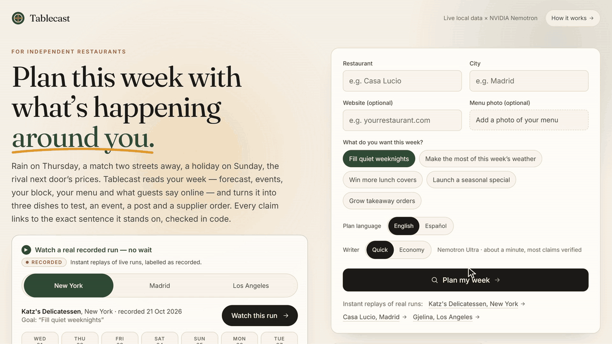
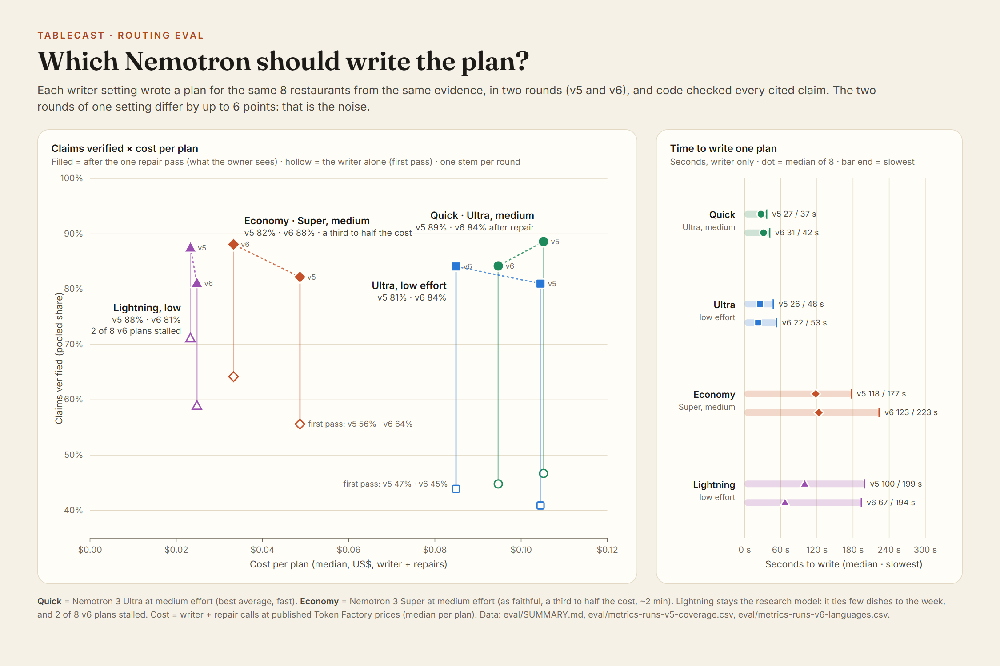
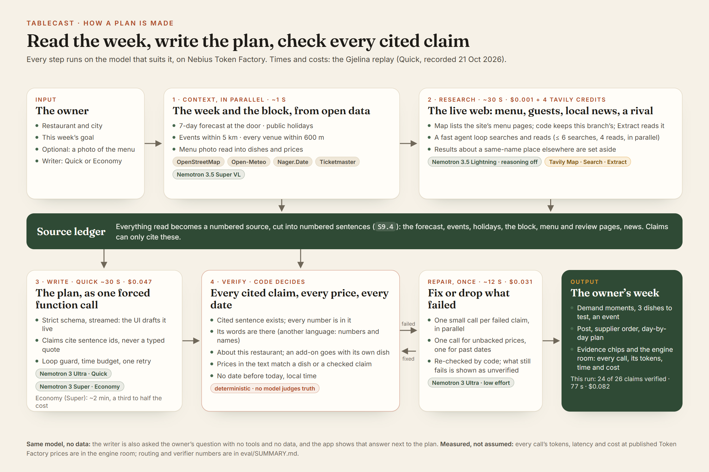
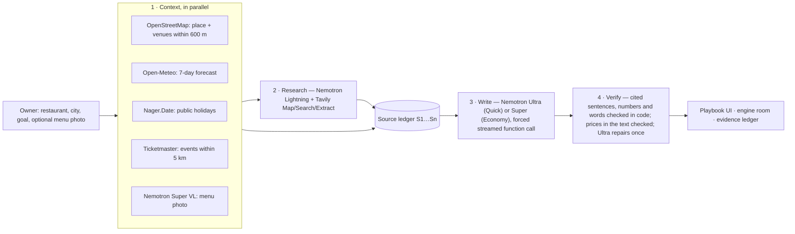

# Tablecast — plan a restaurant’s week with what’s happening around it



**An AI agent on NVIDIA Nemotron (Nebius Token Factory) that reads an independent restaurant’s coming week — the forecast at its door, holidays, events nearby, the venues on its block, its own menu and what guests say online — and turns it into three dishes to test, an event, a ready-to-post campaign, a supplier order and a day-by-day plan. Every cited claim points to the exact sentences it stands on, and code checks that those sentences contain its numbers and its words.** In a claim-by-claim audit of 100 verified claims, 94 were correct ([eval/AUDIT.md](eval/AUDIT.md)).

**Live demo: https://tablecast-app.vercel.app** · **Video (2:36): https://youtu.be/Ni4OlFJ6yrQ**

Built for the **Nebius × NVIDIA Global AI Hackathon** · Track: **Best Apps and Agents** · also entering **Best Use of Tavily** · License: MIT

- **Live demo:** [tablecast-app.vercel.app](https://tablecast-app.vercel.app)
- **Routing eval:** [eval/SUMMARY.md](eval/SUMMARY.md) · **held-out round:** [8 new restaurants](eval/SUMMARY.md#v7-held-out-round) · **verifier audit:** [eval/AUDIT.md](eval/AUDIT.md) · **Tavily ablation:** [eval/TAVILY.md](eval/TAVILY.md)

---

## Judge in 60 seconds

1. Open the [live demo](https://tablecast-app.vercel.app) and click one of the **instant replays** under the form — on a phone, right below the intro (real recorded runs, labelled as recorded and with the writer that made them — no waiting). London is the one with a moment only the live web knew: the Ballon d’Or comes to London on 26 Oct, found by Tavily, not by the events API.
2. Look at **Your week**: the 7-day forecast, holidays and events within 5 km, then the **demand moments** the agent drew from them.
3. In the green header, read **“N / N claims verified against their sources”**. Hover or tap any source chip (`S3 gjelina.com ×3`) to see the exact sentences it cites — plus any neighbouring line the check needed — with a link to open the page. A claim that failed the check is marked in place, with the reason.
4. Jump to **Proof & engine**: the evidence ledger (every source fetched in that run, and the check of every price in the plan’s text), Nemotron answering *without* data, and the **engine room** — every Nemotron call with its tokens, latency and cost.
5. Then type any restaurant and city and run it live: **Quick** (Nemotron Ultra writes: about 1–2 minutes end to end, the writer itself ~30 s; the best average in my eval) or **Economy** (Nemotron Super writes: about 2–3 minutes, a third to half the cost, as faithful). Optionally add a photo of its menu.

## The problem

A restaurant’s week is shaped by things outside its walls: a wet Thursday, a match two streets away, a public holiday, a rival’s new menu. Chains plan for them with insight teams; an independent owner finds out on the night. Generic AI doesn’t help: ask it what to add this week and every restaurant gets the same answer, with nothing to check. Tablecast gives the owner a plan grounded in *this* week, *this* street and *this* menu — and shows its sources.

## How it uses NVIDIA Nemotron on Nebius Token Factory

Every model call goes to **Nebius Token Factory** (`https://api.tokenfactory.nebius.com/v1/`, OpenAI-compatible) and every step runs on the Nemotron that suits it — the track’s own advice (“Ultra for serious reasoning, Nano/Super for the fast, everyday calls”) made into an explicit, measured routing:

| Step | Model | How | Why this model |
|---|---|---|---|
| Web research loop | **Nemotron 3.5 Lightning** (`nvidia/Nemotron-3_5-Lightning`) | tool calling, `reasoning_effort: "none"`, tools requested in one turn run **in parallel** | many short “what to look up next” decisions; median 0.6 s per turn at $0.06/M input tokens |
| Menu photo | **Nemotron 3.5 Super VL** (`nvidia/Nemotron-3.5-Super-VL`) | image input → forced function call → structured menu (dish, price, section) | the only vision model in the family; grounds dishes in the real menu |
| Writing the plan — **Quick** (default) | **Nemotron 3 Ultra** (`nvidia/Nemotron-3-Ultra-550b-a55b`), `reasoning_effort: "medium"` | one **forced, streamed function call** against a strict Zod/JSON schema; the UI drafts the plan live from partial JSON | best average over my two strict eval rounds (89% and 84% of claims verified after repair; 73% on 8 held-out restaurants) and fast (writer median ~30 s, ~1–2 min end to end) |
| Writing the plan — **Economy** | **Nemotron 3 Super** (`nvidia/nemotron-3-super-120b-a12b`), `reasoning_effort: "medium"` | same call; if it runs out of time, Ultra takes over | a third to a half of Ultra’s cost per plan and as faithful (82% and 88%; 74% held-out), but ~2 min to write (2–3 min end to end) |
| Repairs | **Nemotron 3 Ultra** at `reasoning_effort: "low"` | forced function calls, only for what failed a code check: one call per failed claim (in parallel), one call for unbacked prices | Lightning fixed almost none of the failed citations; Ultra-low fixes or drops them in ~10 s; every fix is re-checked by code |
| Generic baseline | **the writer model** (Ultra or Super) | no tools, no data | the honest “same model, without the week” comparison shown in the app |

Engineering details that came out of running it live:

- **Measured, not assumed.** Every call’s `usage` (prompt, completion and reasoning tokens) and wall-clock time (plus time-to-first-token on streams) is emitted as an `engine` event and shown in the app’s **engine room** with its cost at published Token Factory prices. A plan costs a few US cents.
- **Reasoning-loop guard.** On some inputs Ultra’s chain of thought started repeating the same sentence until it hit `max_tokens`. The stream is watched: the same sentence six times in a row (or only two distinct sentences among the last 16) cuts the call, and the plan is rewritten with `reasoning_effort: "low"` — said out loud in the agent log. The same retry covers `finish_reason: "length"`.
- **Schema repair.** If the forced call ever breaks the schema, Lightning gets one chance to fix only the listed issues; the result is validated again.
- **A time budget per run.** A stream that goes silent for a minute is cut and retried; one writing attempt may take at most 150 s (170 s for Super); and every run plans backwards from the host’s function limit, so the retry and the repair pass only get the time that is really left. Non-streamed calls never wait more than 90 s, and a research turn no more than 20 s: if Lightning hangs, Ultra takes over the research instead of the run losing it.
- **Routing eval.** [`scripts/eval-routing.ts`](scripts/eval-routing.ts) gathers the evidence for 8 fixed restaurants once, then has Ultra (medium / low effort), Super and Lightning each write the plan from the *same* evidence, and compares published plans, retries, verified claims (first pass and final), prices backed, how many dishes tie to this week’s data, latency and cost. Full results and limits: **[eval/SUMMARY.md](eval/SUMMARY.md)**. Latest round (v6, 32 plans; verification shares pooled over all claims):

| Writer | Verified, first pass | Verified, after repair | Prices in the text backed (after repair) | Dishes tied to this week | Writes in (median) | Cost / plan (median) |
|---|---|---|---|---|---|---|
| Ultra · medium (**Quick**) | 45% | 84% | 100% | 71% | 31 s | $0.095 |
| Ultra · low | 44% | 84% | 100% | 67% | 22 s | $0.085 |
| Super · medium (**Economy**) | 64% | 88% | 100% | 67% | 123 s | $0.033 |
| Lightning · low (2 of 8 stalled) | 59% | 81% | 40% | 28% | 67 s | $0.025 |

  **Why first pass went 35% → 73% → 45%.** The check got stricter; the writer didn't get worse. Citing sentence ids instead of copying quotes took Ultra's first pass from 35% to 73% (low effort, v3 → v4): most failures had been copy errors. Then I audited my own demos like a judge would and found the v4 check too lenient. One shared word was enough, so "confit tomato, oregano, basil" passed against a menu line without oregano or basil, and a $24 headline sat next to a $22 dish. v5 requires the claim's words to be in what it cites and checks every price in the plan's text. v6 handles sources in another language than the plan (numbers and names are checked; words can't be). Every writer lost first-pass points (Quick: 76% in v4, 47% in v5, 45% in v6), while the share verified after the repair pass stayed at 84–89% under the strict check. Between v5 and v6, two samples of every writer on the same evidence, final verification moved by up to 6 points for the same setting, so I treat gaps under ~5 points as noise. Ultra at medium effort has the best average (89%, 84%) and writes Quick. Super is as faithful (82%, 88%) at a third to half the cost but takes ~2 minutes, so it writes Economy. Lightning stays the research model: it ties few of its dishes to the week.



**v7, then a held-out round (21 Oct).** A judge-style review of my own showcase found three things the v6 check let through: an English menu read as Italian because of its dish names, an add-on ("Add egg $3") paired with the wrong dish, and a plan that scheduled an order for the day before it ran. Each became a rule (see *How every cited claim is verified*). Re-checked on the 46 cached plans with no model calls, v7 rejects 39 claims v6 had passed. 15 of those had a real error, and 24 were correct but worded beyond their lines. It also finds 28 fields dated before the plan's own date, in 16 plans. Then, to answer "you tuned v3–v6 on the same 8 restaurants", I ran 8 new ones, listed in [eval/heldout.json](eval/heldout.json) and committed before any run ([results](eval/SUMMARY.md#v7-held-out-round)):

| Held-out, v7 (8 new restaurants) | Quick (Ultra) | Economy (Super) | Same model, no tools, no data |
|---|---|---|---|
| Plans published | 8/8 (one after a retry I added: a server error had killed the run) | 8/8 | 8/8 |
| Claims verified, first pass → after repair | 38% → **73%** (tuning set: 84%; 82% re-checked with v7) | 63% → **74%** (88%; 82%) | nothing cited, nothing checkable |
| Dishes tied to this week's data | 42% | 33% | 0 of 48 (read by hand) |
| Proposed dishes already on the fetched menu | 0/24 | 0/24 | 0/48 by exact name |
| Plan fields dated before the restaurant's today | 0 of 165 dates | 0 of 154 | – |
| Time, end to end (median / slowest) | 59 s / 75 s (writer 20 s) | 157 s / 203 s | 2–3 s |
| Cost per plan (median) | $0.096 + $0.002 research | $0.041 + $0.002 | under $0.004 |

Held-out is lower. About 2–6 points of the drop come from v7's stricter check and about 8–9 from new restaurants. I report it as measured. Then I read 150 claims, half from this round, against their sources ([eval/AUDIT.md](eval/AUDIT.md)). **94 of 100 verified claims were correct**, 4 had a minor slip and 2 were wrong. Of 50 rejected claims, 12 were true and fully cited (rejected for wording). That audit was done claim by claim by me, the author, with Claude Code's help. It is not independent.

### Where Token Factory accelerated my workflow

- **One endpoint, four Nemotrons.** Because Token Factory is OpenAI-compatible, the official `openai` SDK worked unchanged, and switching the writer between Ultra, Super and Lightning is a one-line routing change. That is what made the routing eval cheap enough to run five times while I changed the verifier.
- **Measured decisions for a few dollars.** Five routing rounds (157 plans: 8 restaurants × 4 writer settings, each round after a change to the verifier) cost **$8.01** of inference in total at published Token Factory prices, the Tavily ablation $1.47, and the held-out round (16 plans and 16 no-data baselines on 8 new restaurants) $1.16. The Quick/Economy routing, the reasoning effort and the switch to sentence-id citations all came out of those numbers.
- **Cost visible per call.** `usage` (with `reasoning_tokens`) plus the public price catalog let the app show what every plan cost, call by call, while it runs.

## How it uses Tavily

Tavily is the agent’s eyes on the live web — three endpoints, each with a job — and its results change the plan:

- **Map** (`select_paths` for menu-like paths, `max_breadth: 150`) lists the menu pages of the restaurant’s own site; code keeps this branch’s (a Los Angeles restaurant’s `/new-york-menus` and `/las-vegas-menus` are set aside) and **Extract** reads the best one before research starts, so the plan stands on the real menu instead of a guessed URL. Only the pages returned are billed (1 credit per 10).
- **Search** (`topic`, `time_range: "week"`, `country`) finds the restaurant’s site and menu, what guests and critics say, what is happening locally this week, and a same-cuisine rival’s menu.
- **Extract** (`query` + `chunks_per_source`, plain text) reads the chosen pages, focused on what is needed (“menu dishes and prices”).
- Lightning decides the queries and which pages to read, within a budget (6 searches, 4 page reads, counting the menu page read after Map). Every result becomes a numbered source the writer must cite, so web facts are verified exactly like the forecast or the map. Tavily credits per run are reported in the engine room (`include_usage`).

**Only the live web knew.** In the London replay (Dishoom Covent Garden, recorded 21 Oct with v7), Ticketmaster listed 25 shows that week. Only Tavily's news search found that the Ballon d’Or ceremony comes to London for the first time on Mon 26 Oct. The plan builds a moment and a dish around it (a pistachio kulfi with fizz for that night), and both claims are verified against the press release.

**What it adds, measured ([eval/TAVILY.md](eval/TAVILY.md)).** The Quick writer wrote each of the 8 eval restaurants' cached evidence twice, with and without the Tavily sources, and code compared the plans. Tavily does not raise the *number* of verified claims (12.3 with vs 13.4 without per plan, within the noise of one sample of 8; 11.6 with the subject check below, which rejects five of them). It changes what they are about. With Tavily, 47% of verified claims cite a page it found. 7 of 8 plans show a menu checked on a fetched page (0 of 8 without), 50% of dishes cite the restaurant's own menu (0%), and 6 of 8 plans verify what guests or critics say (0 of 8). Without it, the writer lists a menu from memory (5 of 33 items are on the real one) and, in 3 of 8 plans, proposes as "new" dishes items it lists as already on the menu. The same eval shows the weak spots: only 1 of 8 plans cites a competitor's price, and five verified claims were about another place or item (now caught by the subject check). Map isn't measured there: the cached packs predate it (what it finds now is in the same file). Cost: a median of 5 Tavily credits per plan (range 2–6).

## How every cited claim is verified (code decides, not a model)

1. Everything the agent sees becomes a numbered source — `S1` the forecast, `S2…` events, then web pages, the block, the menu photo — and every source is cut into numbered sentences (`S9.1`, `S9.2`, …).
2. The writer backs each claim with the ids of the sentences it stands on: `cites: [{ span: "S9.4" }]`. It never types a quote; the server shows the owner the exact cited sentence, so a quote can't be mis-copied or invented.
3. The server checks, deterministically ([`src/lib/evidence.ts`](src/lib/evidence.ts)):
   - every cited sentence exists in this run's sources;
   - **every number in the claim** (prices, °C, mm, distances, dates, times) appears in a cited sentence or the lines next to it — for menu and site pages the line before and the two after, because menus put a dish, its price and its description on separate lines (decimals and glued prices like `Malai15.50` normalised);
   - **the claim says what its sentences say**: every content word of the claim (dish names, ingredients, places, days) must be in them, except at most one in five (one for claims of 4–9 words, none for shorter ones). The restaurant’s own name and street, connective words (“brings”, “costs”) and forecast vocabulary don’t count; “Wednesday” matches “Wed”, “highs” matches “max”, plurals match singulars. A neighbouring line that the check needed is shown to the owner next to the quote. Only if this fails, and the cited page is clearly written in another language (its running text, not a few dish names: an English menu with “Cacio e Pepe” stays English), does the check fall back to every number plus a shared name, and the claim is labelled as read across languages.
   - **the claim is about this restaurant** ([`src/lib/subject.ts`](src/lib/subject.ts)): loved-for, watch-outs, its event and its dishes must cite pages that name it (or its own site), not another branch’s page or sentence (another city), and not a combo or add-on price as a dish’s own. An add-on line (“Add egg $3”) belongs to the dish right above it, so a claim that pairs it with another dish fails. That was the claim in my own showcase replay before v7. Names decide, not the research step’s labels. On the cached eval, the subject check rejects 6 of 543 verified claims, and on reading all six rejections were correct (a competitor’s private room under Dishoom, the Las Vegas Gjelina’s review, Katz’s combo price).
4. Claims that fail go to Nemotron Ultra (low effort) once — one small call per claim, in parallel, with candidate sentences — and a fix is kept only if it passes the same check. What still fails is shown to the owner as **unverified**, not hidden.
5. **Prices in the plan’s text** (headline, plays, event, post, reasoning, week plan) aren’t claims, but owners read them as facts. Each money amount must equal one of the plan’s dish prices, a price printed next to that dish on the menu, or a number in a verified claim. One repair call fixes or removes the rest; code re-checks, and anything still unbacked is listed under Proof.
6. **Dates.** The writer gets the restaurant’s own date (its time zone, confirmed by the forecast’s first day) and the week as a calendar. Code reads every explicit date in the day-by-day plan, the moments, the dishes, the event and the post. Anything before today gets one repair call; a day-plan line still in the past is dropped, and the rest is listed under Proof. Before this, 16 of 46 cached plans began their week on the day before they were made.

**How good is “verified”?** I read 100 verified and 50 rejected claims, a seeded random sample with half from the held-out round, against their cited lines ([eval/AUDIT.md](eval/AUDIT.md), every verdict listed). 94 of the verified claims were correct, 4 had a minor slip (for example “Thursday morning” for a whole-day forecast), and 2 were wrong. Both wrong ones kept every word of their sentence but changed its meaning: rave reviews read as complaints, and a metaphor about jazz read as live music. 37 of 50 rejections were right, and 12 rejected true, fully cited claims for their wording (“reviewers call …”). The audit was done claim by claim by me, the author, with Claude Code’s help; it is not an independent human audit.

Why sentences and not quotes: I started with "copy a verbatim quote" and measured it. The writer often copied the right words under the wrong source id, or paraphrased; on some runs only 3 of 19 claims passed on the first try. Citing sentence ids removed that whole class of error, and what the check catches now are real mistakes (in one London run: a group menu quoted at £32.50 when the page says £36.50, and a "combined value" the model had computed itself).

A second guard handles **same-name restaurants**: a web result or page only becomes a source if it is on the restaurant's own site or mentions its city, street or postcode. (In one run, a "Casa Lucio" in another Spanish town had slipped its menu into the evidence; the verifier couldn't see it, because the quotes were genuine.)

## Architecture





Stack: Next.js 16 (App Router, streaming NDJSON), React 19, Tailwind 4, Zod 4, the official `openai` SDK pointed at Token Factory, Leaflet + OpenStreetMap tiles, Vitest.

## Run it from scratch

```bash
git clone https://github.com/antonmareo10/tablecast.git && cd tablecast
npm install
cp .env.example .env.local   # then fill in the keys below
npm run dev                  # http://localhost:3000
```

| Variable | Required | Where |
|---|---|---|
| `NEBIUS_API_KEY` | yes | [tokenfactory.nebius.com](https://tokenfactory.nebius.com) |
| `TAVILY_API_KEY` | yes | [tavily.com](https://tavily.com) (free tier works) |
| `TICKETMASTER_API_KEY` | optional | [developer.ticketmaster.com](https://developer.ticketmaster.com) (events nearby) |
| `NEBIUS_FAST_MODEL`, `NEBIUS_MODEL`, `NEBIUS_ECONOMY_MODEL`, `NEBIUS_VISION_MODEL`, `NEBIUS_REASONING_EFFORT` | optional | routing overrides (defaults in `.env.example`) |

Checks: `npm run typecheck` (generates Next's route types first, so it works on a fresh clone), `npm run lint`, `npm test` (unit tests for the verifier, the price and date checks, the menu parser and every data source; `LIVE=1 npm test` also hits the keyless APIs). Routing eval: `npm run eval` (= `npx tsx scripts/eval-routing.ts`; needs the API keys); held-out round: `npx tsx scripts/eval-routing.ts --restaurants eval/heldout.json --runs runs-v7-heldout --configs ultra-medium,super-medium` then `npx tsx scripts/eval-heldout.ts`; re-check cached plans with the current verifier: `npx tsx scripts/v7-recheck.ts`; audit sample: `npx tsx scripts/audit-sample.ts`. Record an instant replay: `node scripts/record-demo.mjs "Casa Lucio" "Madrid" "Fill quiet weeknights" http://localhost:3000`.

## Responsible by design

- **Web pages are data, never instructions.** Fetched text is quoted to the models with an explicit rule to ignore instructions inside it; the agent’s only tools are search and read — it cannot post, buy or send anything.
- **No personal data.** Public pages, open data and aggregate listings only.
- **The owner decides.** Dishes are bets to test for a week; nothing is ordered or posted automatically.
- **Public demo limits.** Per-IP and daily caps on live runs; recorded runs are labelled as recorded.
- **Credits.** Map data © OpenStreetMap contributors (ODbL); weather by Open-Meteo (CC BY 4.0); holidays by Nager.Date; events by Ticketmaster; web research by Tavily. Recorded runs contain third-party page excerpts, so they are shipped with the deployment and kept out of this repository.

## Known limitations

- Verification proves that every cited sentence exists in a fetched source and contains every number of the claim and nearly all of its words — not that the source is right, nor that the claim reads it correctly. One word in five may be missing, so a small embellishment can still pass; the source chip lets the owner check. In the audit, 2 of 100 verified claims were wrong in a way code can't see (all the words are there, the meaning isn't), and 4 had a minor slip. Nothing here measures sales: the plan is a set of bets to test for a week.
- On a menu page, a price on the line after a dish's description can belong to the next dish; the number check allows the line before and the two after, so such a pairing can pass. True claims about a competitor can sit under the restaurant's own watch-outs when they name the competitor openly.
- The strict check rejects some true claims for their wording (12 of 50 rejections in the audit); the repair pass gets one chance to rephrase each, and what still fails is shown as unverified. Held-out restaurants verify less than the 8 used for tuning (73–74% after repair vs 82% re-checked with v7).
- Only explicit dates are checked: "Tuesday" alone is not tied to a date.
- Forecasts beyond ~3 days are uncertain; event listings come from one ticketing API and miss free or local events unless the web research finds them.
- Public Overpass servers are often saturated; the app then falls back to Nominatim, which caps results, and says so (“at least N venues, partial list”).
- Reviews found on the web are not a sample of all guests. Eight tuning restaurants and eight held-out ones is a small eval.

## What was built during the submission period

Everything here. The project started on 16 Oct 2026 as **Tastecraft**, an agent over a proprietary taste-graph API with a hosted LLM ([github.com/antonmareo10/tastecraft](https://github.com/antonmareo10/tastecraft)), entered in another hackathon. This repository is a rebuild for open infrastructure, renamed **Tablecast** on 21 Oct 2026 because it is a different product — the week around a restaurant rather than its audience’s taste. The whole agent runs on NVIDIA Nemotron via Nebius Token Factory with measured routing; the evidence layer is live web research (Tavily) and open data (OpenStreetMap, Open-Meteo, Nager.Date) plus Nemotron VL for menu photos; and it adds a code-level verifier (cited sentences, numbers, words and prices), reasoning-loop guard and time budgets, engine telemetry, a routing eval and the Quick/Economy routing it led to. It makes no call to, and holds no data from, the other project’s proprietary API.

## Feedback on Nebius Token Factory and NVIDIA Nemotron

- **What worked well.** The OpenAI-compatible API meant the official `openai` SDK worked unchanged. Lightning with `reasoning_effort: "none"` is a fast, reliable tool dispatcher (median 0.6 s per turn, correct parallel tool calls). Ultra produced large schema-valid structured output through forced function calls, streamed; Super at medium effort writes for about half of Ultra’s cost. `usage` with `reasoning_tokens` made per-call cost accounting easy, and the public `models_info` catalog (prices, context, throughput) is very handy.
- **Rough edges.**
  - Model-ID casing is inconsistent across docs and catalog (`Nemotron-3_5-Lightning`, `nemotron-3-super-120b-a12b`, `Nemotron-3.5-Super-VL`); I had to read `GET /v1/models` to pin exact strings. A copy button or canonical lowercase IDs would help.
  - Ultra occasionally loops in its reasoning (the same sentence repeated until `max_tokens`) on long, multi-source prompts — at medium effort in my v3 round, once at low effort in v5. A server-side repetition guard or a `max_reasoning_tokens` parameter separate from `max_tokens` would make reasoning budgets safer.
  - Effort levels don't bound reasoning tightly. Writing the same plan (v5, median of 8 runs each), reasoning tokens were about a third of Ultra's output (32–35%), 74% of Super's at `medium` and 76% of Lightning's at `low`.
  - Throughput differs a lot by model, which shapes routing: median output tokens per second of writing time in v5 were about 320 for Ultra, 175 for Lightning and 125 for Super. Super's stream went silent for over a minute mid-plan in 2 of 8 plans in each of the last two rounds, and Lightning's in 2 of 8 when I tried it as the writer. Published per-model throughput and latency in the catalog, kept current, would help routing decisions.
  - On 21 Oct, for several minutes, Lightning requests with tools hung for 60+ s while plain Lightning calls, Ultra and Super answered in under a second. A per-model status page, or a fast error instead of a hang, would let agents fail over sooner.
  - In the held-out round a Quick stream failed server-side with Python's "Exceeds the limit (4300 digits) for integer string conversion": the model had streamed a 4,305-digit number inside the tool-call JSON and the server's parser rejected it mid-stream. A clear finish reason (or a cap on numeric literals in tool arguments) would be easier to handle than an exception; the app now treats it as a failed attempt and retries once.
  - I couldn’t find a spend cap or per-key budget for a public demo; it would make hackathon deployments safer.
