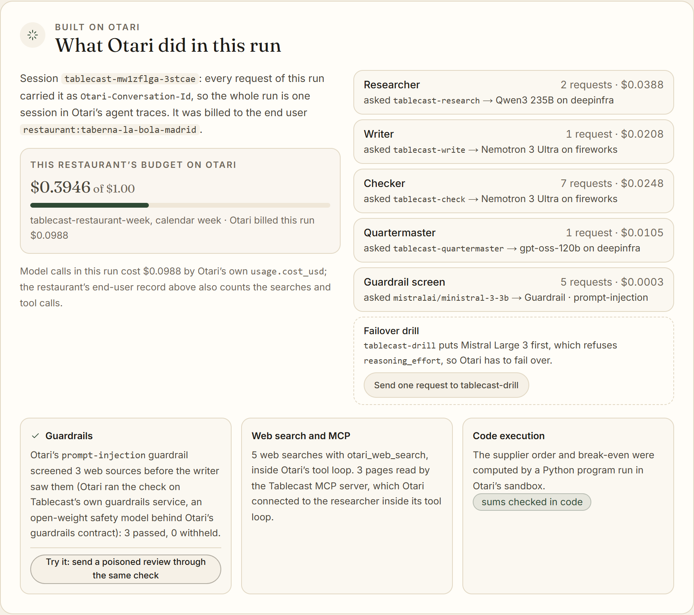

# Tablecast on Otari

Tablecast plans an independent restaurant's coming week from what is happening around it. Every model call, web search, MCP call, guardrail check and code run goes through [Otari](https://otari.ai), the gateway by Mozilla.ai, and every model is open-weight.



*The "What Otari did in this run" panel of a recorded run (Taberna La Bola, Madrid, 4 Nov 2026). Every figure in it comes from Otari's response headers, `usage.cost_usd` and end-user records.*

- Live app: https://tablecast-otari.vercel.app. Two recorded Otari runs play at once. A live run takes 2 to 4 minutes and spends real credit, so on the public page it needs my owner link or the judges' link.
- This branch, `otari-wilding`, is my entry for MozFest Developers Wilding. Otari comes in at commit [d4160e2](https://github.com/antonmareo10/tablecast/commit/d4160e2981f93921f47e9270e47205575c9191ca).
- Otari setup (budgets, service key, routing policies): [docs/OTARI_SETUP.md](docs/OTARI_SETUP.md)

## Who it's for

The owner of a small restaurant on a Monday morning. Rain on Wednesday, a match two streets away, a holiday on Sunday and the rival next door's new prices all change the week, and nobody tells them in time. Tablecast reads the forecast, the holidays, events nearby, the venues on the block, the menu and what guests say online, and turns it into three dishes to test, an event, a post, a supplier order and a day-by-day plan. Every claim points to the exact sentences it stands on, and code checks that those sentences contain its numbers and its words.

## How this app uses Otari

Each row is code that a normal run goes through. The two recorded runs show all of them except the menu photo and the web-fetch fallback, which only run when they are needed.

| Otari feature | What Tablecast does with it | In the code | Where you see it |
|---|---|---|---|
| Open-weight models, each in its own role | Qwen3 235B researches. Nemotron 3 Ultra writes and repairs (Nemotron 3 Super in Economy). gpt-oss-120b writes the program the sandbox runs. gpt-oss-safeguard-20b judges prompt injection. Qwen3 VL reads a menu photo. | [model-runtime.ts](src/lib/model-runtime.ts): `POLICIES`, `gather()`, `synthesize()`, `repairCitations()`, `readMenuPhoto()` · [injection-detector.ts](src/lib/injection-detector.ts): `detectInjection()` | App: "What Otari did in this run", one row per role with the model and provider that answered. Dashboard: Requests. |
| Model routing and fallbacks | The app asks for a routing policy, never a model. Each policy falls back to another provider and model family; `tablecast-write` moves a restaurant to Nemotron 3 Super at 60% of its budget. `Otari-Model`, `Otari-Provider`, `Otari-Attempt-Count` and `Otari-Fallback` are read on every answer. | [model-runtime.ts](src/lib/model-runtime.ts): `POLICIES`, `resolveRouting()` · [otari.ts](src/lib/otari.ts): `servedFrom()` · [failover-drill/route.ts](src/app/api/failover-drill/route.ts) | App: "asked tablecast-write → Nemotron 3 Ultra on fireworks" for each role; the Failover drill button. Dashboard: Routing; Requests (the drill shows two attempts). |
| Web search and web fetch | The researcher searches with `otari_web_search` inside Otari's tool loop, at most 5 times a run. When my own reader can't open a page, Otari's web fetch reads it through the Messages API. | [agent.ts](src/lib/agent.ts): `gatherEvidence()` · [otari-fetch.ts](src/lib/sources/otari-fetch.ts): `otariFetchPage()` | App: "Searching the web: … (Otari web search)" in the agent log. Dashboard: Agent traces, search spans. |
| MCP | Tablecast's page reader is an MCP server (`read_page`, `find_menu_pages`). Each research turn names it in `mcp_servers`; Otari calls it inside its loop, and the text it returns becomes a numbered source. | [mcp-server.ts](src/lib/mcp-server.ts): `TOOLS`, `callTool()`, `inlineMcpServer()` · [api/mcp/route.ts](src/app/api/mcp/route.ts) · [agent.ts](src/lib/agent.ts): `onGatewayCalls` | App: "Reading timeout.com (Tablecast MCP, via Otari)" in the agent log. Dashboard: Agent traces, MCP spans. |
| Code execution | gpt-oss-120b writes one Python program and Otari runs it with `otari_code_execution`: the order by supplier, its total, and the portions that pay for each new dish. My code then checks every sum. | [quartermaster.ts](src/lib/quartermaster.ts): `runQuartermaster()`, `checkResult()` | App: "Computed in Otari's code sandbox" under the shopping list, with the program it ran. Dashboard: Agent traces, code execution span. |
| Guardrails | Each page and search result goes alone through a `prompt-injection` guardrail in block mode before the writer sees it, and Otari refuses flagged text with `403 guardrail_violation`. The EU deployment has no guardrails service, so the guardrail's `url` names my own, on Otari's guardrails contract. | [screen.ts](src/lib/screen.ts): `screenText()` · [guardrail-service.ts](src/lib/guardrail-service.ts): `validateResponse()` · [injection-detector.ts](src/lib/injection-detector.ts): `detectInjection()` | App: the 🛡️ line in the log; "Try it: send a poisoned review through the same check". Dashboard: Requests refused with `guardrail_violation`. |
| Budgets and spending limits | The app's service key has a $12 monthly budget on Otari. When Otari answers `budget_exceeded` for the key or the workspace, or the balance is empty, the server pauses live runs and tells the visitor why. | [limits.ts](src/lib/limits.ts): `isAccountError()`, `describeLiveFailure()` · [otari.ts](src/lib/otari.ts): `OtariError.budgetScope` | App: the message a visitor gets when live runs pause. Dashboard: Spend & budgets, the key's budget. |
| Per-user budgets | Every request names the restaurant as an Otari end user, `restaurant:<name>-<city>`, with its own $1 weekly budget. The app reads it before a run (and refuses one it can't cover, before spending anything) and after it, to show what Otari billed. The judges' link bills one end user of its own. | [otari.ts](src/lib/otari.ts): `restaurantEndUser()`, `completionExtras()` · [otari-budget.ts](src/lib/otari-budget.ts): `endUserStatus()` · [api/agent/route.ts](src/app/api/agent/route.ts) · [judge.ts](src/lib/judge.ts): `judgeBudget()` | App: "This restaurant's budget on Otari", with the bar and what Otari billed this run. Dashboard: Spend & budgets, end users. |

Also used: sessions. Every request of a run carries one `Otari-Conversation-Id` ([otari.ts](src/lib/otari.ts): `otariFetch()`), so a whole run is one session in Otari's agent traces, and the app shows its id.

## The models

All of them are open-weight and run on otari.ai's own hosted providers (EU region), billed to the Otari balance.

| Role | Policy | First choice | Fallbacks |
|---|---|---|---|
| Research | `tablecast-research` | Qwen3 235B A22B Instruct (DeepInfra) | Mistral Small 4 (Mistral), Nemotron Nano 3 30B (Bedrock) |
| Write, Quick | `tablecast-write` | Nemotron 3 Ultra (Fireworks) | GLM 5.2 (DeepInfra), Mistral Small 4 (Mistral); Nemotron 3 Super (DeepInfra) past 60% of the budget |
| Write, Economy | `tablecast-economy` | Nemotron 3 Super (Bedrock) | DeepSeek V4 Flash (DeepInfra), Nemotron 3 Ultra (Fireworks) |
| Check and repair | `tablecast-check` | Nemotron 3 Ultra (Fireworks) | GLM 5.2 (DeepInfra), Mistral Small 4 (Mistral) |
| Supplier order | `tablecast-quartermaster` | gpt-oss-120b (DeepInfra) | gpt-oss-120b (Fireworks), Mistral Small 4 (Mistral) |
| Prompt-injection judge | catalog id `openai/gpt-oss-safeguard-20b` | Bedrock | |
| Guardrail checks | catalog id `mistralai/ministral-3-3b` | one token per check | |
| Menu photo | catalog id `alibaba/qwen3-vl-235b-a22b-instruct` | Otari picks DeepInfra or Bedrock | the other one |
| Failover drill | `tablecast-drill` | Mistral Large 3 (refuses `reasoning_effort`) | Nemotron 3 Ultra (Fireworks) |

If a policy does not exist in the workspace, the app uses the role's catalog id and says so in its log, so it still runs.

## How a run works

1. Context, in code and in parallel: OpenStreetMap finds the restaurant and the venues within 600 m, Open-Meteo gives the 7-day forecast, Nager.Date the holidays, Ticketmaster the events within 5 km (with a key). The reader opens the restaurant's own menu page. Each item becomes a numbered source.
2. Research: the researcher searches through Otari and reads pages through the Tablecast MCP server. Search results are only leads; what the plan uses has to be read. Every page passes the guardrail first.
3. Write: the writer plans the week as one streamed, forced function call. Every claim cites sentence ids, never quotes.
4. Verify: code checks every claim against the sentences it cites (numbers, words, subject, dates, prices). What fails goes to the checker once; a fix is kept only if it passes the same check. What still fails is marked in the plan.
5. Supplier order: the quartermaster's program runs in Otari's sandbox, and code checks its sums.

The verifier is the same as in the Nebius version, the one I built before this; how it works, and how I measured it there, is in [docs/NEBIUS_VERSION.md](docs/NEBIUS_VERSION.md#how-every-cited-claim-is-verified-code-decides-not-a-model).

## What I measured on Otari

These are single runs from 4 Nov 2026, not an eval.

| Run | Where | Sources | Claims verified after repair (first pass) | Time | Billed to the restaurant by Otari |
|---|---|---|---|---|---|
| Dishoom Covent Garden, London (recorded) | deployed app, MCP and guardrail service on | 7 (menu, 2 reviews, local news, a rival, forecast, block) | 12 of 16 (4) | 217 s | $0.174 |
| Taberna La Bola, Madrid (recorded) | deployed app, MCP and guardrail service on | 5 | 11 of 12 (6) | 165 s | $0.099 |
| Taberna La Bola, Madrid | my laptop, MCP and guardrail service on the deployment | 5 | 14 of 14 (12) | 137 s | $0.076 |
| Dishoom Covent Garden, London | my laptop, pages read in-process | 6 | 11 of 14 (6) | 247 s | $0.100 |

In both recorded runs the guardrail passed every web source (6 of 6 and 3 of 3), and the sandbox's supplier order matched the plan's own lines in every sum. In the London recording, Qwen3's first research turn didn't answer in time, so the app gave the research to the checker's policy (Nemotron 3 Ultra); the Madrid recording has Qwen3 researching. Other checks: the failover drill was served by Nemotron 3 Ultra after 2 attempts (`Otari-Fallback: true`) for $0.00005; through Otari, Tablecast's guardrail service passed a clean review and refused a subtle and a plain injection with `403 guardrail_violation` (a handful of texts, not a benchmark). Twice in my first runs, the writer's first streamed attempt stopped after about 14,000 characters and stayed silent until the app cut it and wrote again; the stall cut is now 30 s.

Development on Otari cost about $1 of the $20 credit (Otari's end-user records plus my local ledger), as of 4 Nov.

The verification figures in the Nebius README (for example 186 of 212 verified claims right when I read a whole held-out round) were measured with Nemotron on Nebius. The Otari version uses the same verifier but other models for research and another page reader, and I have not re-run those evals on it.

## What I built around Otari

Three things Otari didn't give me on its hosted EU deployment, so I built them on its own extension points:

- A page reader that returns the exact text, served as an MCP server, because on Chat Completions Otari's search and fetch give the page text to the model but only report the URL back to the app, and Tablecast has to check claims against the sentences themselves.
- A prompt-injection guardrail service on Otari's guardrails contract, because the EU deployment has no guardrails service and every built-in guardrail needs a vendor key.
- A read of each restaurant's end-user record before and after a run, to know what the whole run cost, because searches and tool calls are not in the cost of each model answer.

## Run it yourself

```bash
git clone https://github.com/antonmareo10/tablecast.git && cd tablecast
git checkout otari-wilding
npm install
cp .env.example .env.local      # then add your OTARI_API_KEY
npm run dev                     # http://localhost:3000
```

| Variable | Needed | What it is |
|---|---|---|
| `OTARI_API_KEY` | yes | An Otari service key (see [docs/OTARI_SETUP.md](docs/OTARI_SETUP.md)). An ordinary key works too, but then runs are not billed per restaurant. |
| `OTARI_BASE_URL` | no | `https://eu.api.otari.ai/api/v1` (default) or `https://api.otari.ai/api/v1` for a US account |
| `TABLECAST_MCP_URL`, `TABLECAST_MCP_TOKEN` | for MCP | The public HTTPS address of `/api/mcp` and a long random token. Without them the reader runs in-process. |
| `TABLECAST_GUARDRAIL_URL`, `TABLECAST_GUARDRAIL_TOKEN` | for guardrails | `https://<deployment>/api/guardrails/<token>` and the same token. Without them, web sources are marked as not screened. |
| `LIVE_RUNS_TOKEN` | no | When set, live runs need `?live=<token>` in the page's address; recorded runs stay open to everyone. The page takes the token out of the address bar as soon as it loads. |
| `JUDGE_LINK_TOKEN`, `JUDGE_BUDGET_ID` | no | The judges' link, `?judge=<token>` (at least 24 characters), and the Otari budget its end user must be on (docs/OTARI_SETUP.md, section 7). Optional: `JUDGE_END_USER`, `JUDGE_LINK_EXPIRES`, `JUDGE_SPEND_CAP_USD`, `JUDGE_RUNS_PER_HOUR` (3), `JUDGE_RUNS_PER_DAY` (6). |
| `TICKETMASTER_API_KEY` | no | Events within 5 km |
| `OTARI_LOCAL_CAP_USD` | no | The local spending cap (default 6), on top of Otari's budgets |

Checks: `npm test` (unit tests with Otari's answers mocked, including the MCP route and the guardrails service against their protocols), `npm run typecheck`, `npm run lint`, `npm run build`. Live checks: `node --env-file=.env.local scripts/otari-smoke.mjs --paid` (every feature, a few cents) and `node --env-file=.env.local scripts/otari-e2e.mjs <deployment domain>` (Otari connecting to the deployed MCP server and guardrail service). Record a replay: `node --env-file=.env.local scripts/record-demo.mjs "Casa Lucio" "Madrid" "Fill quiet weeknights" <base url>`.

## Known limitations

- The MCP server and the guardrail service have to be reachable by Otari over HTTPS, so on a laptop they need a deployed copy (the app falls back to the in-process reader, and marks sources as not screened).
- The guardrail judge is mine (rules plus an open-weight safety model), checked on a handful of texts. It screens a source as far as the writer will read it, in pieces of 2,000 characters. If it can't run, the source is kept and counted as unscreened, not as passed.
- Otari's search results reach the app as URLs and titles, so the researcher has to read a page before the plan can use it; when it reads little, the plan stands on few sources (5 to 7 in the recorded runs).
- My reader does not run JavaScript; when it fails, Otari's fetch gets a second try.
- The budget tier-down needs a restaurant past 60% of its weekly budget. Neither recorded run reached it, so it is configured in the policy but not shown happening.
- The supplier order's matching of ingredients to order lines is the model's (names never match exactly); code checks the sums and the break-even arithmetic, not the matching. The shopping list's own costs come from the writer.
- Nothing here measures sales. A plan is a set of bets to test for a week, and verification proves that each cited claim matches its sentences, not that the plan is right.

## More

- Submission notes, the feature-by-feature table I sent and my written feedback on Otari: [docs/OTARI_SUBMISSION.md](docs/OTARI_SUBMISSION.md)
- The version before Otari (Nebius Token Factory and Tavily), with its measured figures: [docs/NEBIUS_VERSION.md](docs/NEBIUS_VERSION.md)

## Credits

Models, web search and fetch, guardrails and the code sandbox through Otari by Mozilla.ai. Map data © OpenStreetMap contributors (ODbL), weather by Open-Meteo (CC BY 4.0), holidays by Nager.Date, events by Ticketmaster. Recorded runs contain third-party page excerpts, so they ship with the deployment and are kept out of this repository. License: MIT.
