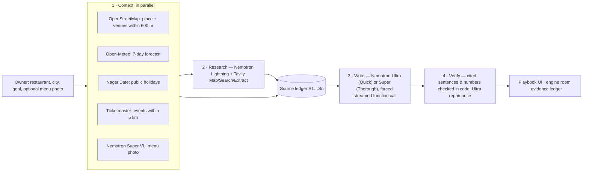

# Tastecraft — plan a restaurant’s week with what’s happening around it

**An AI agent on NVIDIA Nemotron (Nebius Token Factory) that reads an independent restaurant’s coming week — the forecast at its door, holidays, events nearby, the venues on its block, its own menu and what guests say online — and turns it into three dishes to test, an event, a ready-to-post campaign, a supplier order and a day-by-day plan. Every claim cites the exact sentences it stands on, and code checks each one.**

Built for the **Nebius × NVIDIA Global AI Hackathon** · Track: **Best Apps and Agents** · also entering **Best Use of Tavily** · License: MIT

- **Live demo:** [tastecraft-open.vercel.app](https://tastecraft-open.vercel.app)
- **Routing eval:** [eval/SUMMARY.md](eval/SUMMARY.md)

---

## Judge in 60 seconds

1. Open the [live demo](https://tastecraft-open.vercel.app) and click one of the **instant replays** under the form (real recorded runs, labelled as recorded — no waiting).
2. Look at **Your week**: the 7-day forecast, holidays and events within 5 km, then the **demand moments** the agent drew from them.
3. In the green header, read **“N / N claims checked against their sources”**. Hover or tap any source chip (`S3 gjelina.com ×3`) to see the exact sentences it cites, with a link to open the page. A claim that failed the check is marked in place, with the reason.
4. Jump to **Proof & engine**: the evidence ledger (every source fetched in that run), Nemotron answering *without* data, and the **engine room** — every Nemotron call with its tokens, latency and cost.
5. Then type any restaurant and city and run it live: **Quick** (Nemotron Ultra writes, about a minute) or **Thorough** (Nemotron Super writes, 2–3 min, the most claims verified first time). Optionally add a photo of its menu.

## The problem

A restaurant’s week is shaped by things outside its walls: a wet Thursday, a match two streets away, a public holiday, a rival’s new menu. Chains plan for them with insight teams; an independent owner finds out on the night. Generic AI doesn’t help: ask it what to add this week and every restaurant gets the same answer, with nothing to check. Tastecraft gives the owner a plan grounded in *this* week, *this* street and *this* menu — and shows its sources.

## How it uses NVIDIA Nemotron on Nebius Token Factory

Every model call goes to **Nebius Token Factory** (`https://api.tokenfactory.nebius.com/v1/`, OpenAI-compatible) and every step runs on the Nemotron that suits it — the track’s own advice (“Ultra for serious reasoning, Nano/Super for the fast, everyday calls”) made into an explicit, measured routing:

| Step | Model | How | Why this model |
|---|---|---|---|
| Web research loop | **Nemotron 3.5 Lightning** (`nvidia/Nemotron-3_5-Lightning`) | tool calling, `reasoning_effort: "none"`, tools requested in one turn run **in parallel** | many short “what to look up next” decisions; ~0.5–2 s per turn at $0.06/M input tokens |
| Menu photo | **Nemotron 3.5 Super VL** (`nvidia/Nemotron-3.5-Super-VL`) | image input → forced function call → structured menu (dish, price, section) | the only vision model in the family; grounds dishes in the real menu |
| Writing the plan — **Quick** (default) | **Nemotron 3 Ultra** (`nvidia/Nemotron-3-Ultra-550b-a55b`), `reasoning_effort: "low"` | one **forced, streamed function call** against a strict Zod/JSON schema; the UI drafts the plan live from partial JSON | fastest writer in our eval (median 33 s); 96% of claims verified after repair |
| Writing the plan — **Thorough** | **Nemotron 3 Super** (`nvidia/nemotron-3-super-120b-a12b`), `reasoning_effort: "medium"` | same call; if it runs out of time, Ultra takes over | most faithful first time (94% verified before repair, 98% after) at a third of Ultra’s cost per plan, but ~2 min to write |
| Citation repair | **Nemotron 3 Ultra** at `reasoning_effort: "low"` | forced function call, only for claims that failed the code check | we measured it: Lightning fixed almost none of the failed citations, Ultra-low fixes or drops them in ~10 s; every fix is re-checked by code |
| Generic baseline | **the writer model** (Ultra or Super), low effort | no tools, no data | the honest “same model, without the week” comparison shown in the app |

Engineering details that came out of running it live:

- **Measured, not assumed.** Every call’s `usage` (prompt, completion and reasoning tokens) and wall-clock time (plus time-to-first-token on streams) is emitted as an `engine` event and shown in the app’s **engine room** with its cost at published Token Factory prices. A typical plan costs a few US cents.
- **Reasoning-loop guard.** On some inputs Ultra’s chain of thought started repeating the same sentence until it hit `max_tokens`. The stream is now watched: the same sentence six times in a row (or only two distinct sentences among the last 16) cuts the call, and the plan is rewritten with `reasoning_effort: "low"` — said out loud in the agent log. The same retry covers `finish_reason: "length"`.
- **Schema repair.** If the forced call ever breaks the schema, Lightning gets one chance to fix only the listed issues; the result is validated again.
- **A time budget per run.** A stream that goes silent for a minute is cut and retried; one writing attempt may take at most 150 s (170 s for Super); and every run plans backwards from the host’s function limit, so the retry and the repair pass only get the time that is really left. Non-streamed calls never wait more than 90 s, and a research turn no more than 20 s (median 0.6 s): if Lightning hangs, Ultra takes over the research instead of the run losing it.
- **Routing eval.** [`scripts/eval-routing.ts`](scripts/eval-routing.ts) gathers the evidence for 8 fixed restaurants once, then has Ultra (medium / low effort), Super and Lightning each write the plan from the *same* evidence, and compares published plans, retries, verified claims (first pass and final), how many dishes tie to this week’s data, latency and cost. Full results and limits: **[eval/SUMMARY.md](eval/SUMMARY.md)**. The headline numbers (medians, 32 plans):

| Writer | Verified, first pass | Verified, after repair | Dishes tied to this week | Writes in | Cost / plan |
|---|---|---|---|---|---|
| Ultra · low (**Quick**) | 73% | 96% | 71% | 33 s | $0.075 |
| Ultra · medium | 76% | 96% | 67% | 39 s | $0.065 |
| Super · medium (**Thorough**) | 94% | 98% | 71% | 127 s | $0.023 |
| Lightning · low | 89% | 94% | 25% | 94 s | $0.008 |

  Switching from copied quotes to cited sentence ids took Ultra’s first pass from 35% to 73% on the same restaurants. Lightning copies faithfully but rarely ties its dishes to the week, so it stays the research model.

### Where Token Factory accelerated our workflow

- **One endpoint, four Nemotrons.** Because Token Factory is OpenAI-compatible, the official `openai` SDK worked unchanged, and switching the writer between Ultra, Super and Lightning is a one-line routing change. That is what made the routing eval cheap enough to run three times while we changed the verifier.
- **Measured decisions for a few dollars.** Three eval rounds (93 plans: 8 restaurants × 4 writer settings, each round after a change to the verifier) cost **$3.73** of inference in total at published Token Factory prices. The Quick/Thorough routing, the low reasoning effort and the switch to sentence-id citations all came out of those numbers.
- **Cost visible per call.** `usage` (with `reasoning_tokens`) plus the public price catalog let the app show what every plan cost, call by call, while it runs.

## How it uses Tavily

Tavily is the agent’s eyes on the live web — three endpoints, each with a job — and its results change the plan:

- **Map** lists the pages of the restaurant’s own site (when known) so the agent opens the real menu page instead of guessing it.
- **Search** (`topic`, `time_range: "week"`, `country`) finds the restaurant’s site and menu, what guests and critics say, what is happening locally this week, and a same-cuisine rival’s menu.
- **Extract** (`query` + `chunks_per_source`, plain text) reads the chosen pages, focused on what is needed (“menu dishes and prices”).
- Lightning decides the queries and which pages to read, within a budget (6 searches, 4 page reads). Every result becomes a numbered source the writer must quote, so web facts are verified exactly like the forecast or the map. Tavily credits per run are reported in the engine room (`include_usage`).

## How every claim is verified (code decides, not a model)

1. Everything the agent sees becomes a numbered source — `S1` the forecast, `S2…` events, then web pages, the block, the menu photo — and every source is cut into numbered sentences (`S9.1`, `S9.2`, …).
2. The writer backs each claim with the ids of the sentences it stands on: `cites: [{ span: "S9.4" }]`. It never types a quote; the server shows the owner the exact cited sentence, so a quote can't be mis-copied or invented.
3. The server checks, deterministically ([`src/lib/evidence.ts`](src/lib/evidence.ts)):
   - every cited sentence exists in this run's sources;
   - **every number in the claim** (prices, °C, mm, distances, dates, times) appears in a cited sentence — or the line right next to it, for menus that put a dish and its price on separate lines (decimals and glued prices like `Malai15.50` normalised);
   - the cited sentences share content with the claim (an irrelevant citation fails).
4. Claims that fail go to Nemotron Ultra (low effort) once — one small call per claim, in parallel, with candidate sentences — and a fix is kept only if it passes the same check. What still fails is shown to the owner as **unverified**, not hidden.

Why sentences and not quotes: we started with "copy a verbatim quote" and measured it. The writer often copied the right words under the wrong source id, or paraphrased; on some runs only 3 of 19 claims passed on the first try. Citing sentence ids removed that whole class of error, and what the check catches now are real mistakes (in one London run: a group menu quoted at £32.50 when the page says £36.50, and a "combined value" the model had computed itself).

A second guard handles **same-name restaurants**: a web result or page only becomes a source if it is on the restaurant's own site or mentions its city, street or postcode. (In one run, a "Casa Lucio" in another Spanish town had slipped its menu into the evidence; the verifier couldn't see it, because the quotes were genuine.)

## Architecture



Stack: Next.js 16 (App Router, streaming NDJSON), React 19, Tailwind 4, Zod 4, the official `openai` SDK pointed at Token Factory, Leaflet + OpenStreetMap tiles, Vitest.

## Run it from scratch

```bash
git clone https://github.com/antonmareo10/tastecraft-open.git && cd tastecraft-open
npm install
cp .env.example .env.local   # then fill in the keys below
npm run dev                  # http://localhost:3000
```

| Variable | Required | Where |
|---|---|---|
| `NEBIUS_API_KEY` | yes | [tokenfactory.nebius.com](https://tokenfactory.nebius.com) |
| `TAVILY_API_KEY` | yes | [tavily.com](https://tavily.com) (free tier works) |
| `TICKETMASTER_API_KEY` | optional | [developer.ticketmaster.com](https://developer.ticketmaster.com) (events nearby) |
| `NEBIUS_FAST_MODEL`, `NEBIUS_MODEL`, `NEBIUS_THOROUGH_MODEL`, `NEBIUS_VISION_MODEL`, `NEBIUS_REASONING_EFFORT` | optional | routing overrides (defaults in `.env.example`) |

Checks: `npx tsc --noEmit`, `npx eslint .`, `npm test` (unit tests for the verifier and every data source; `LIVE=1 npm test` also hits the keyless APIs). Routing eval: `npx tsx scripts/eval-routing.ts`. Record an instant replay: `node scripts/record-demo.mjs "Casa Lucio" "Madrid" "Fill quiet weeknights" http://localhost:3000`.

## Responsible by design

- **Web pages are data, never instructions.** Fetched text is quoted to the models with an explicit rule to ignore instructions inside it; the agent’s only tools are search and read — it cannot post, buy or send anything.
- **No personal data.** Public pages, open data and aggregate listings only.
- **The owner decides.** Dishes are bets to test for a week; nothing is ordered or posted automatically.
- **Public demo limits.** Per-IP and daily caps on live runs; recorded runs are labelled as recorded.
- **Credits.** Map data © OpenStreetMap contributors (ODbL); weather by Open-Meteo (CC BY 4.0); holidays by Nager.Date; events by Ticketmaster; web research by Tavily. Recorded runs contain third-party page excerpts, so they are shipped with the deployment and kept out of this repository.

## Known limitations

- Verification proves that every cited sentence exists in a fetched source, that every number in the claim appears in it and that it is about the same thing — not that the source is right, nor that the claim reads the sentence correctly (the source chip lets the owner check). Nothing here measures sales: the plan is a set of bets to test for a week.
- Forecasts beyond ~3 days are uncertain; event listings come from one ticketing API and miss free or local events unless the web research finds them.
- Public Overpass servers are often saturated; the app then falls back to Nominatim, which caps results, and says so (“at least N venues, partial list”).
- Reviews found on the web are not a sample of all guests.

## What was built during the submission period

Everything here. Tastecraft started on 16 Oct 2026 as an agent over a proprietary taste-graph API with a hosted LLM ([github.com/antonmareo10/tastecraft](https://github.com/antonmareo10/tastecraft)). This repository is a rebuild for open infrastructure: the whole agent now runs on NVIDIA Nemotron via Nebius Token Factory with three-model routing, and the evidence layer was replaced by live web research (Tavily) and open data (OpenStreetMap, Open-Meteo, Nager.Date) plus Nemotron VL for menu photos, with a new code-level verifier (cited sentences + numbers), reasoning-loop guard and time budgets, engine telemetry, a routing eval and the Quick/Thorough routing it led to.

## Feedback on Nebius Token Factory and NVIDIA Nemotron

- **What worked well.** The OpenAI-compatible API meant the official `openai` SDK worked unchanged. Lightning with `reasoning_effort: "none"` is a fast, reliable tool dispatcher (~0.5–2 s per turn, correct parallel tool calls). Ultra produced large schema-valid structured output through forced function calls, streamed; Super at medium effort was the most faithful writer we measured, at a third of Ultra’s cost. `usage` with `reasoning_tokens` made per-call cost accounting easy, and the public `models_info` catalog (prices, context, throughput) is very handy.
- **Rough edges.**
  - Model-ID casing is inconsistent across docs and catalog (`Nemotron-3_5-Lightning`, `nemotron-3-super-120b-a12b`, `Nemotron-3.5-Super-VL`); we had to read `GET /v1/models` to pin exact strings. A copy button or canonical lowercase IDs would help.
  - Ultra at `reasoning_effort: "medium"` occasionally loops in its reasoning (the same sentence repeated until `max_tokens`) on long, multi-source prompts. A server-side repetition guard or a `max_reasoning_tokens` parameter separate from `max_tokens` would make reasoning budgets safer.
  - Effort levels don't bound reasoning tightly. Writing the same plan (median of 8 runs each), reasoning tokens were 46% of Ultra's output at `low`, 77% of Super's at `medium` and 83% of Lightning's at `low`. That is why a separate reasoning budget matters for latency and cost.
  - Throughput is good and differs a lot by model, which shapes routing. Median output speed while streaming a plan: Ultra ≈ 290 tok/s, Lightning ≈ 196 tok/s, Super ≈ 138 tok/s. Super's slowest write took 207 s. Published per-model throughput and latency in the catalog, kept current, would help routing decisions.
  - We couldn’t find a spend cap or per-key budget for a public demo; it would make hackathon deployments safer.
